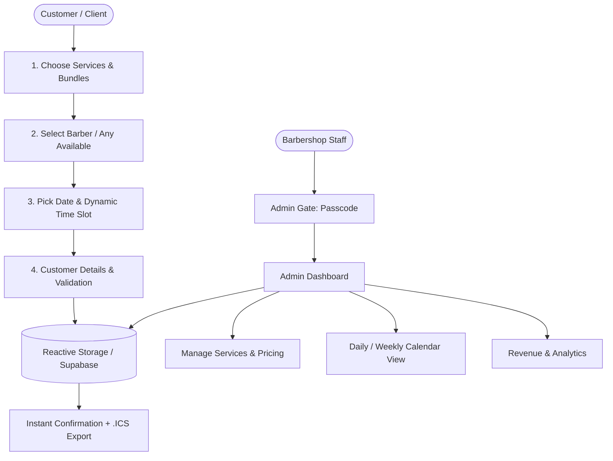

# ✂️ Barbershop Appointment Planner

> A modern, mobile-first appointment and schedule planner for barbershops built with **React 18**, **TypeScript**, and **Tailwind CSS**. Features real-time slot conflict prevention, dynamic service duration calculation, automated 24h background appointment reminders, customer self-service portal, and password-protected staff administration.


---

## 🌟 Key Features

### 1. 📱 Mobile-First 4-Step Booking Flow
- **Step 1: Service Selection**: Filterable by category (*Haircuts*, *Beard & Shave*, *Color & Tone*, *Bundles*, *Kids*). Supports multi-selection and automatic bundle discount detection.
- **Step 2: Artisan Choice**: Choose "Any Available Barber" (recommended for fastest availability) or pick a master barber with photos, ratings, bio, and specialties.
- **Step 3: Dynamic Date & Time Picker**: 30-day horizontal date slider. Time slot generator calculates slot availability dynamically based on the **exact total duration** of selected services plus buffer sanitation time. Past, fully booked, and break times are automatically disabled.
- **Step 4: Review & Confirmation**: Clean price breakdown, friendly form validation, instant confirmation screen with confetti animation, Google Calendar sync, and downloadable `.ics` calendar file.

### 2. 🛡️ Conflict Prevention & Availability Engine
- **Zero Double-Booking**: Time slot overlaps are evaluated per barber and across the salon in real-time.
- **Dynamic Slot Duration**: Whether a customer books a 20-minute beard trim or a 90-minute VIP package, the calendar reserves the full time window plus configurable sanitation buffers (default 5 min).
- **Simulated Notifications**: Dispatches simulated SMS and 24-hour reminder confirmations.

### 3. 🔍 Customer Self-Service Portal
- Lookup past or upcoming appointments by **Booking Reference ID** (e.g. `CB-8491`) or **Phone Number**.
- Self-service **rescheduling** with automatic conflict checks.
- One-click appointment **cancellation** that immediately restores the time slot for other customers.

### 4. 💼 Password-Protected Staff Admin Dashboard
- **Passcode Protected**: Default demo passcode: `admin123`.
- **Calendar & Timeline**: Daily and weekly views of all chairs. Filter by barber or status (`confirmed`, `completed`, `cancelled`).
- **Manual Bookings**: Easily insert walk-in customers.
- **Block Out Time**: Block individual barber shifts or the entire shop for lunch, maintenance, or vacation.
- **Service Catalog Manager**: Add, edit prices, change durations, or toggle services live.
- **Shop Analytics**: Real-time stats on bookings per day, revenue, and popular service distributions.

---

## 🧠 Software Engineering Highlights & Architecture

This application was engineered following real-world software engineering practices and architectural patterns:

| Engineering Concept | Implementation in this Project |
| :--- | :--- |
| **Interval Scheduling Algorithm** | Computes slot availability dynamically based on aggregated multi-service durations $\sum(\text{duration}_i) + \text{sanitation\_buffer}$. Employs interval overlap detection $O(N)$ to guarantee mathematical zero double-booking across concurrent barber chairs. |
| **Event-Driven Reactive State** | Uses a reactive event bus architecture with `CustomEvent` dispatchers (`cb_storage_update`, `cb_auto_reminder_fired`) to synchronize state instantly between the customer booking flow, staff admin dashboard, and background workers without polling. |
| **Outbox Pattern & Background Workers** | Implements an asynchronous 24-hour lead-time scheduler with an in-app **Transactional Outbox Logger**, decoupling email/SMS delivery dispatch from user interactions for maximum fault tolerance. |
| **Domain-Driven Design (DDD)** | Strongly typed domain entities (`Appointment`, `ServiceBundle`, `BarberChair`, `TimeSlot`, `OutboxMessage`) with strict TypeScript compiler flags (`noImplicitAny`, `strictNullChecks`). |
| **RFC-5545 iCalendar Standards** | Generates compliant `.ics` calendar files with embedded `VALARM` triggers (RFC-5545 24h lead reminder) compatible with Apple Calendar, Google Calendar, and Outlook. |
| **Mobile-First UX & Accessibility** | Responsive layout built with Tailwind CSS, strictly meeting WCAG AA accessibility standards including 44px minimum interactive touch targets (`min-h-touch`), semantic HTML5, and persistent dark/light theme switching. |

---

## 🏗️ Architecture & Data Flow



---

## 🚀 Quick Start Guide

### Prerequisites
- [Node.js](https://nodejs.org/) (v18 or higher recommended)
- [npm](https://www.npmjs.com/) or [pnpm](https://pnpm.io/)

### Installation & Local Run

```bash
# 1. Clone the repository
git clone https://github.com/<YOUR-USERNAME>/crown-and-blade.git
cd crown-and-blade

# 2. Install dependencies
npm install

# 3. Start development server
npm run dev
```

Open your browser at `http://localhost:5173` to view the application.

### Building for Production
```bash
npm run build
npm run preview
```

---

## 🛠️ How to Customize Services & Prices

You have two convenient ways to edit or expand services:

### Method A: Through the Admin Dashboard (No Code Required)
1. In the header bar, click the **Staff** button (shield icon).
2. Enter the passcode: `admin123`.
3. Go to the **Services & Bundles** tab.
4. Click **New Service / Bundle** or click the **Edit** icon next to any existing item.
5. Change the title, description, price, duration, or bundle status, and click **Save Service**. Your changes persist immediately!

### Method B: In Code (For Permanent Defaults)
Edit `src/data/mockData.ts`:
```typescript
{
  id: 'srv-custom-cut',
  name: 'Custom / Styled Cut',
  description: 'Precision scissor styling and skin fade.',
  durationMinutes: 45,
  price: 55, // <-- Update price here
  category: 'cuts',
  popular: true,
  active: true,
}
```

---

## 🗄️ Optional Supabase Production Backend

This repository includes a production-ready PostgreSQL / Supabase schema in `supabase/schema.sql`.

To link Supabase:
1. Create a project on [Supabase](https://supabase.com).
2. Run the SQL script from `supabase/schema.sql` in the Supabase SQL editor.
3. Create a `.env` file in the root directory:
```env
VITE_SUPABASE_URL=https://your-project.supabase.co
VITE_SUPABASE_ANON_KEY=your-anon-public-key
```

---

## 📤 How to Push This Project to GitHub

Follow these steps to publish this repository to your GitHub account:

```bash
# 1. Initialize git and check status
git status

# 2. Go to https://github.com/new and create a new repository:
#    Repository name: crown-and-blade (or barbershop-booking)
#    Visibility: Public
#    (Do not check 'Add a README' or '.gitignore' since we already have them)

# 3. Link your local repo to GitHub and push (replace YOUR-USERNAME):
git remote add origin https://github.com/YOUR-USERNAME/crown-and-blade.git
git branch -M main
git push -u origin main
```

---

## 👨‍💻 Author

**Software Engineering Student Portfolio Project**  
Crafted with attention to clean code principles, mobile responsiveness, and realistic business domain logic.

